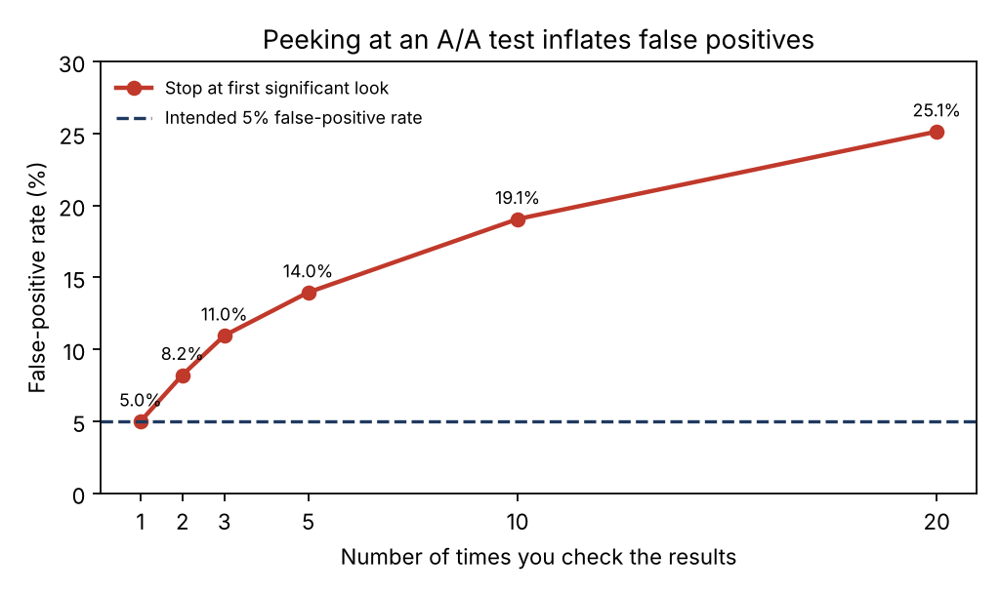
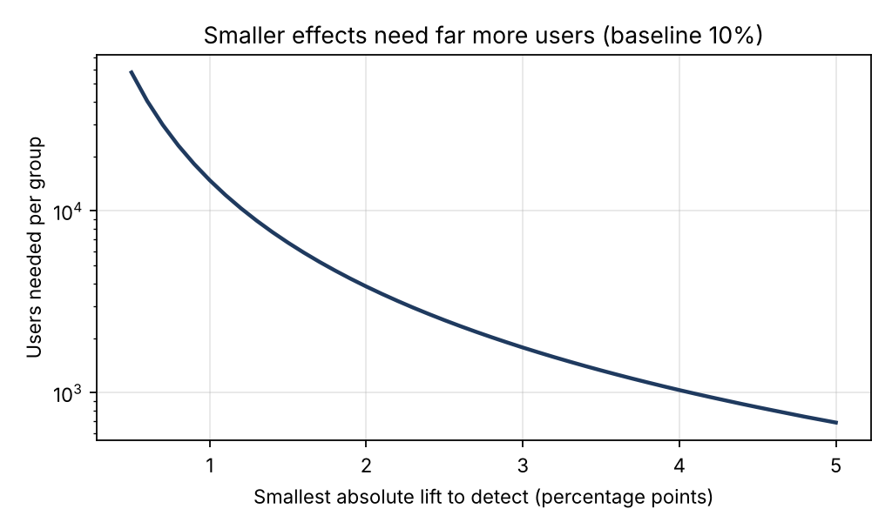

# Results

Produced on 2026-11-16 with Python 3.12.3 (seed 42). Re-run to reproduce.

## Unit tests
`PYTHONPATH=src python -m unittest discover -s tests`

```
----------------------------------------------------------------------
Ran 9 tests in 0.183s

OK
```

## Simulations
`PYTHONPATH=src python -m abkit.simulate`

```
Empirical power at the planned sample size (target 0.80):
  n per group = 3841, power = 0.795
False-positive rate of an A/A test when you stop at the first significant look:
   1 looks -> 0.050
   2 looks -> 0.082
   5 looks -> 0.140
  10 looks -> 0.191
  20 looks -> 0.251
```

Interpretation: at the planned sample size, simulated experiments with a true lift reached significance about as often as the 80% power target. In A/A tests with no real difference, stopping at the first significant look raised the false-positive rate well above the nominal 5%, and the rate grew with the number of looks.

## Not done yet
- Analysis of a real public experiment dataset and a written decision memo
- Continuous-metric tests and variance reduction

## Figures
Regenerate with `PYTHONPATH=src python scripts/make_figures.py` (needs matplotlib).




