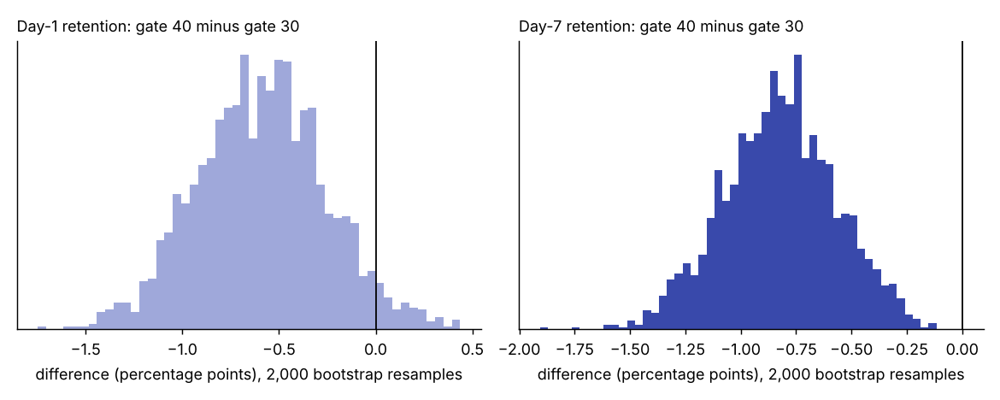

# Decision memo: move the first gate in Cookie Cats from level 30 to level 40?

Data: 90,189 players of Cookie Cats, randomly assigned (see `data/real/README.md`). Raw output: `cli_output.txt`.

## 1. Hypothesis
Moving the first gate (where players must wait or pay to continue) from level 30 to level 40 will increase retention, because players hit the forced break later, after they are more invested.

## 2. Design
- Unit: player, assigned at install. Control = gate at 30, treatment = gate at 40.
- Primary metric: 7-day retention (did the player come back 7 days after install). This is closer to long-term value than day 1.
- Secondary: 1-day retention. Guardrail: game rounds played in the first 14 days.
- Power: at 19% baseline 7-day retention, 23,668 players per group detect a 1-point change at 80% power; 37,135 detect 0.8 points. The test has about 45,000 per group, so it can detect changes of around 0.75 points.

## 3. Validity checks
- Sample ratio: 44,700 vs 45,489 players. Chi-square p = 0.0086. That is below 0.05 but above the 0.001 threshold the toolkit uses to block a result. The imbalance is 1.8%, too small to explain the result, but I would still ask the team how assignment worked.
- One control player logged 49,854 rounds in 14 days (next highest is about 2,900). This does not affect the retention metrics, but it would distort a mean-rounds guardrail, so I report medians.
- Dates and changes during the test: not in the dataset.

## 4. Results

| Group | Players | 1-day retention | 7-day retention | Median rounds |
|---|---|---|---|---|
| Gate 30 (control) | 44,700 | 44.82% | 19.02% | 17 |
| Gate 40 | 45,489 | 44.23% | 18.20% | 16 |

- **7-day retention: −0.82 points (95% CI −1.33 to −0.31), relative −4.3%, p = 0.0016.**
- 1-day retention: −0.59 points (95% CI −1.24 to +0.06), p = 0.074. Not significant.
- A bootstrap with 2,000 resamples agrees: the 7-day difference was below zero in all 2,000 resamples, and the 1-day difference was below zero in 96%.

## 5. Decision
**Do not ship. Keep the gate at level 30.** 7-day retention is lower with the gate at 40. The best plausible case is a 0.3-point loss and the worst is 1.3 points. Day 1 points the same way. One explanation: the gate gives players a forced break, and the break brings them back. Moving it later removes that break for the period that matters most.

## 6. Risks and next steps
- Retention is not revenue. The gate is also where players can pay, and this dataset has no purchase data. Check revenue per player before the decision is final.
- Next test: try an earlier gate (level 20 or 25) to see whether the effect continues in the same direction.
